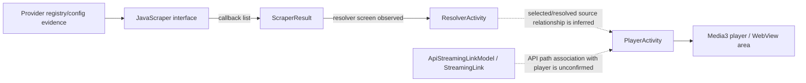
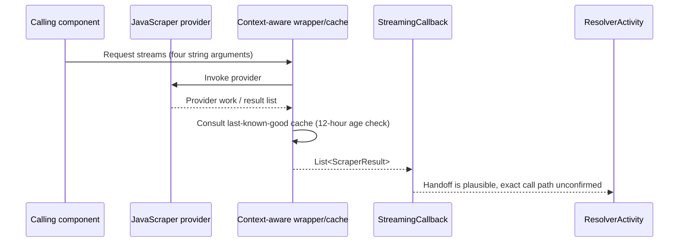

# DooFlix APK inspection report

## Scope and method

Inspected the supplied `DooFlix_v10.5_Fm.apk` as a local reference using Android SDK `aapt`, `dexdump`, and the official JADX 1.5.6 CLI. APK tooling and decompiled files were kept in a temporary inspection directory and are not part of the website project. No provider endpoint was called and no APK code was copied into DoomsPlay.

JADX identified 20,299 classes across the APK. A full-project decompile stopped at 84% after Windows reported that the paging file was too small. A retry with a capped heap and serial garbage collector stalled around 36% and was stopped after sustained memory pressure. Targeted decompiles succeeded for the Java scraper interface, result model, `PlayerActivity`, and `ResolverActivity`; other model/registry classes were inspected from partial output. The three DEX files and APK manifest/assets were also inspected with Android SDK tools. Therefore this is not a claim that every APK method was fully decompiled or dynamically tested. Provider-specific scraper extraction details are not reproduced as an integration recipe; the inventory below records what can be safely established and what remains missing.

## Package and manifest facts

- Package: `com.king.moja`; version name `10.5`, version code `315`.
- Compile SDK 36, target SDK 36, minimum SDK 26.
- APK contains `classes.dex`, `classes2.dex`, and `classes3.dex`.
- The manifest includes Internet and network-state permissions. Its network security config permits cleartext traffic; DoomsPlay does not inherit that policy and its stream resolver requires HTTPS.
- `ResolverActivity` and `PlayerActivity` are declared activities. The player activity supports picture-in-picture and landscape playback.

## Verified architecture observations

### Local scraper-to-player path (evidence bounded)

The solid connections represent relationships supported by the recovered interface or component evidence. Dotted connections are architectural inferences only; static analysis did not establish a complete caller-to-player chain for every source type.

### Callback and worker flow

The APK evidence establishes the interface, callback data type, and cache behavior. It does not establish a universal worker implementation, request fan-out policy, duplicate handling, or a provider-independent error contract.

### Local Java scraper callback path

The decompiled `com.dooflixv4.in.services.scraper.java.JavaScraper` interface defines provider identity/name/priority and a `getStreams` method with four string inputs. Its callback receives a list of `ScraperResult`. The context-aware wrapper uses a last-known-good local cache with a 12-hour age check and calls the callback with returned results. The exact semantic mapping of all four string parameters is not established by the method signature alone.

`ScraperResult` has fields for URL, stable input, provider, name/title, quality, size, priority, headers, download-only status, and whether WebView resolution is required. This is a normalized result model; it does not make a source authorized or playable.

The DEX contains scraper classes whose names are obfuscated (`a` through `i`), flags such as `JAVA_SCRAPER_*_ENABLED`, and names matching the website inventory. There is also evidence of a remote registry/config mechanism. A registry response model contains `runtime` and `scrapers`; the runtime object includes version and Cheerio URL/hash fields. The authoritative remote registry URL, current runtime registry contents, and per-provider authorization cannot be established from the supplied static evidence.

### API-based source path

Static endpoint inventory includes the PlayLT base URL `https://api-plhq.playlt.xyz/apiv5/` and stream path `api/video/stream/get`. A decompiled call site confirms a POST to that path with JSON containing an `id` extracted from an `/e/{id}`-shaped input. This confirms an observed call shape in this APK; it does not establish that the service is live, that DoomsPlay may use it, or that it is authorized for the user’s content.

The response is handed to an obfuscated generic JSON model/parser. The APK also contains `StreamingLink` and `ApiStreamingLinkModel` types with fields such as ID, provider, URL, host, quality, size, type, order, season number, episode number, headers, download-only status, WebView-resolution flag, and subtitle data. Those model fields alone do not prove the endpoint returns a particular schema. Authentication/interceptor behavior and the response contract remain unverified.

The local JavaScraper interface and the API call are distinct code paths. The available evidence does not prove whether the API path is a fallback, how the two paths are sequenced, or which one is used for a given title.

### Resolver and player

`ResolverActivity` is a distinct resolver screen and includes quality-text recognition for a `###p`-style label. The APK’s player activity contains AndroidX Media3 player views, an HLS media-source factory, subtitle UI, an HTTP data-source fallback, and a WebView area. WebView navigation can pass a header map. These are Android implementation capabilities, not evidence that a corresponding provider URL is directly playable in a web browser.

The APK contains observed strings for `User-Agent`, `Referer`, `Origin`, `Authorization`, `Cookie`, `X-Requested-With`, and nonce-related headers. Static string presence does not assign a header to a provider request. No per-provider header/auth matrix is confirmed. Provider extraction selectors, host-specific redirect chains, anti-bot behavior, and signed-link requirements are not used by DoomsPlay.

### Confirmed fields and unresolved data flow

| Stage | Confirmed from static evidence | Not confirmed |
| --- | --- | --- |
| Scraper output | `ScraperResult` includes URL, stable input, provider/name/title, quality, size, priority, headers, download-only, and WebView-required fields. | Which fields are mandatory and how every provider fills them. |
| API model | `StreamingLink` / `ApiStreamingLinkModel` contain source, provider, URL/host, quality, type/order, episode coordinates, headers, and subtitle-related fields. | A definitive response schema for the observed API or its mapping to every player request. |
| Resolver | `ResolverActivity` exists and recognizes quality text. | Whether it selects, validates, or resolves every result, and the exact Intent extras contract. |
| Player | `PlayerActivity` contains Media3, HLS support, subtitle UI, HTTP data-source fallback, and WebView handling. | Which upstream component supplies each final URL and format; HLS/browser compatibility outside Android. |

No recoverable evidence establishes a complete confirmed `StreamingCallback → ScraperResult → ResolverActivity → PlayerActivity` Intent contract. The dotted edges above must remain inferences. Static evidence also does not show that the player validates source authorization; DoomsPlay's allowlist/MIME checks are independent safeguards, not a port of APK behavior.

### Per-provider class and DEX attribution limits

The 17 inventory entries in the next section are provider/service references recoverable from strings, configuration names, and partial decompilation. The analysis artifacts available in this workspace do not provide a reliable one-to-one mapping from every provider reference to a Java/Kotlin class descriptor and DEX definition offset. Provider class names `a` through `i` are obfuscated and cannot safely be assigned display names from the present evidence. Therefore, an exact provider FQCN, source path, and DEX file for each inventory row are **unavailable**, not inferred from a domain name. The confirmed JavaScraper FQCN is `com.dooflixv4.in.services.scraper.java.JavaScraper`; the recovered report identifies the `ScraperResult` model by simple name but does not establish its full descriptor. The APK contains three DEX files: `classes.dex`, `classes2.dex`, and `classes3.dex`.

## Provider-by-provider result

The IDs, names, domains, endpoints, notes, and original evidence classes below are preserved in `lib/streaming/providers/index.ts`. “Playback: no” means there is no documented, authorized implementation enabled in DoomsPlay; it does not claim that an observed domain is offline.

| ID | Existing configured entry | Evidence from existing registry | Playback conclusion |
| --- | --- | --- | --- |
| `app-backend` | PlayLT / App Backend | Confirmed URL string; endpoint call shape additionally seen in decompiled code | Disabled. User permission, auth policy, supported catalog mapping, and exact response contract are missing. |
| `tmdb` | The Movie Database (TMDB) | Confirmed URL string | Official metadata/catalog API only. Search and season metadata do not provide video media. |
| `trakt` | Trakt | Confirmed URL and OAuth strings | Account/scrobble metadata reference; no playback contract configured. |
| `gofile-api` | Gofile API | Confirmed host API URL strings | Host API strings do not supply an authorized movie/episode mapping. |
| `drivehub` | DriveHub / ExtraDrive | Domain only | No documented authorized API or content mapping. |
| `hdhub` | HDHub | Domain only | No documented authorized API or content mapping. |
| `hdm2` | HDm2 / HDFLIX | Path pattern | WordPress/player path evidence only; no documented authorized integration. |
| `mkv` | MKV | Domain only | No documented authorized API or content mapping. |
| `superstream` | SuperStream | Path pattern | Path/config-key strings only; concrete authorized origin/API is missing. |
| `watchkar` | Watchkar | Domain only | Domain and HLS-related references only; no documented authorized catalog or extraction API. |
| `gdtot` | GDTOT / GDTOT-V2 | Path pattern | URL patterns only; no authorized content mapping or resolver contract. |
| `hdmovie2` | HDMovie2 | Domain only | Domain/UI/scraper class references only; no documented authorized API. |
| `hubcloud` | HubCloud | Domain only | Downstream host reference only. |
| `pixeldrain` | PixelDrain | Path pattern | File API/path evidence only; no authorized content IDs/mapping. |
| `gofile` | Gofile | Path pattern | Host path only; no authorized content mapping. |
| `vidsrc` | VidSrc | Path pattern | Embed/AJAX path evidence only; no authorized or stable playback API. |
| `other-hosts` | Other embedded host domains | Domain only | Hostname evidence only; no documented endpoint or content mapping. |

### Endpoint evidence

The preserved `endpoints` export contains 27 records. It includes TMDB/Trakt, PlayLT, host API strings, a WordPress AJAX path, embed/file API paths, and generic movie/TV/download route templates. The records keep their original `UNCONFIRMED` methods and evidence labels. The PlayLT POST/body observation above is supplemental analysis; the registry’s original evidence fields were intentionally not rewritten. No endpoint has been live-tested or authorized for DoomsPlay use.

The shared parameter/header arrays are observed strings, not confirmed endpoint-specific mappings. No documented request method, selectors, regex extraction, authentication values, referer/origin requirements, or provider-specific response schema is established for the scraper/host references. Configuration key names in the APK are not treated as credentials; no key is copied to website code or documentation.

## DoomsPlay implementation outcome

The website uses its own provider interface, registry, manager, resolver, diagnostics API, manual source selector, and browser player. It does not call the APK’s services or scrape the listed third-party sites. The runtime provider registry remains empty until an authorized provider contract and content permission are supplied. Movie TMDB ID and TV TMDB ID/season/episode flow through the server route and are covered by tests, but no actual movie/TV source is returned today.

Player capability tests and resolver MIME tests are not actual media playback tests. No authorized playable source was supplied, so browser playback, media CORS, provider redirects, and end-to-end movie/episode decode remain unverified. No sample video was substituted.
