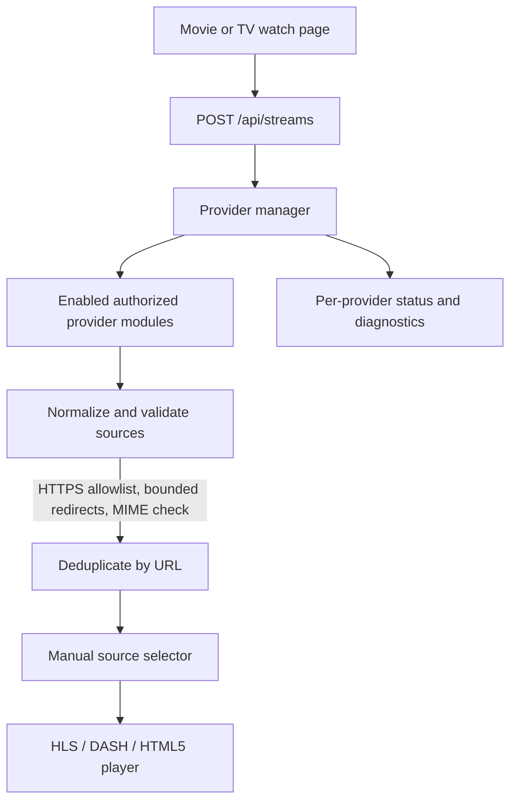

# DoomsPlay streaming status

## Current playback flow

The existing watch page sends the selected TMDB ID, media kind, and (for TV) season and episode to `POST /api/streams`. The route calls `lib/streaming/manager.ts`, which runs only enabled modules registered in `lib/streaming/registry.ts`. The manager validates normalized media sources and the `ServerSelector` lets the viewer choose one manually. The selected HLS, DASH, MP4, or WebM source is then bound to the player in `components/VideoPlayer.tsx`. An iframe is accepted only when a registered provider explicitly marks it as its own authorized player. There is no automatic source fallback.

The evidence inventory in `lib/streaming/providers/index.ts` is kept separate from the executable registry. HDMovie2 is implemented as an independent module in `lib/streaming/providers/hdmovie2.ts`; the remaining inventory entries are references only.



The provider contract supports optional `searchMovie`, `getMovieDetails`, `searchSeries`, `getSeasons`, `getEpisodes`, `getMovieStreams`, and `getEpisodeStreams` methods. `getProviderCapabilities()` reports implemented methods; the manager invokes only the relevant movie or episode method (or the backward-compatible `getSources`).

### Provider capability matrix

“APK evidence” records observed app references, not a public API. No supplied provider has an authorized movie/episode media contract configured in DoomsPlay.

| ID | APK evidence category | Movie streams | Series/episode streams | Search/details/seasons | DoomsPlay playback |
| --- | --- | --- | --- | --- | --- |
| `app-backend` | App backend URL and call-site observation | Unverified | Unverified | Unverified | Disabled; authorization/contract unknown |
| `tmdb` | Metadata API reference | No media API | Metadata only | Metadata only | No playback |
| `trakt` | Account/OAuth strings | Unverified | Unverified | Unverified | Disabled |
| `gofile-api` | Host API strings | Unverified | Unverified | Unverified | Disabled |
| `drivehub` | Scraper/domain references | Unverified | Unverified | Unverified | Disabled |
| `hdhub` | Scraper/domain references | Unverified | Unverified | Unverified | Disabled |
| `hdm2` | Player/AJAX path patterns | Unverified | Unverified | Unverified | Disabled |
| `mkv` | Scraper/domain references | Unverified | Unverified | Unverified | Disabled |
| `superstream` | Scraper/path pattern | Unverified | Unverified | Unverified | Disabled |
| `watchkar` | Scraper/domain references | Unverified | Unverified | Unverified | Disabled |
| `gdtot` | Scraper/path patterns | Unverified | Unverified | Unverified | Disabled |
| `hdmovie2` | Domain and DooPlayer AJAX shape supplied for integration | Implemented; live status unverified | Implemented with strict episode markers; live status unverified | Title/year search and TMDB alternate-title candidates | Configurable; actual playback not verified |
| `hubcloud` | Resolver/downstream host | Unverified | Unverified | Not a catalog API | Disabled |
| `pixeldrain` | Host URL/API patterns | Unverified | Unverified | Not a catalog API | Disabled |
| `gofile` | Host URL pattern | Unverified | Unverified | Not a catalog API | Disabled |
| `vidsrc` | Embed/AJAX path patterns | Unverified | Unverified | Unverified | Disabled |
| `other-hosts` | Embedded host domains | Unverified | Unverified | Not established | Disabled |

Exact class names, source files, and DEX offsets are unavailable per provider in the recoverable evidence; see `APK_REVERSE_ENGINEERING_REPORT.md`. No class attribution is guessed.

`lib/streaming/registry.ts` registers HDMovie2. It is enabled by default and can be disabled with `HDMOVIE2_ENABLED=false`; source hosts must pass the provider allowlist and existing HTTPS/MIME validation. The player supports HLS and HTML5 video, while same-provider embeds use the existing iframe player. Source extraction and mock tests do not establish live playback.

## Provider-by-provider assessment

| Existing ID | Name | Existing evidence | Playback status and missing information |
| --- | --- | --- | --- |
| `app-backend` | PlayLT / App Backend | Confirmed URL string | A decompiled call site shows a POST to the recorded stream path with an `id` JSON field. It is not live-tested or established as authorized for this website. Authentication policy, supported IDs, response contract, and permission to use the service are missing. Kept disabled. |
| `tmdb` | The Movie Database (TMDB) | Confirmed URL string | Documented metadata/search and TV-season APIs; not a media delivery source. A TMDB key is optional for metadata only. No movie or episode playback extraction. |
| `trakt` | Trakt | Confirmed URL string | API/OAuth references only. No configured client, current playback contract, or media delivery interface. |
| `gofile-api` | Gofile API | Confirmed URL strings | Account/content API strings do not identify authorized movie or episode IDs. No catalog mapping or permission for a content source is configured. |
| `drivehub` | DriveHub / ExtraDrive | Domain only | Scraper/domain references only; no documented authorized request/response contract or content mapping. |
| `hdhub` | HDHub | Domain only | Scraper/domain references only; no documented authorized request/response contract or content mapping. |
| `hdm2` | HDm2 / HDFLIX | Path pattern | Player/AJAX path references; no supported authorized integration contract. |
| `mkv` | MKV | Domain only | Scraper and downstream host references; no documented authorized movie/episode API. |
| `superstream` | SuperStream | Path pattern | `/play/` pattern and configuration-key names only; the concrete origin and authorized API contract are unavailable. |
| `watchkar` | Watchkar | Domain only | Host references and an HLS-related code reference; no general documented API, permission, or catalog-to-content mapping. |
| `gdtot` | GDTOT / GDTOT-V2 | Path pattern | File/download path patterns only; no authorized source mapping or supported resolver contract. |
| `hdmovie2` | HDMovie2 | Search page plus `doo_player_ajax` resolution | Searches TMDB title and alternate-title candidates, checks release year, extracts movie sources, and requires exact season/episode attributes for TV. AJAX calls retain User-Agent, Referer, Origin, and X-Requested-With headers. Live selectors, host availability, CORS behavior, and playback remain unverified. |
| `hubcloud` | HubCloud | Domain only | Downstream host reference; not a catalog or authorized media-source API. |
| `pixeldrain` | PixelDrain | Path pattern | File API/path references; no authorized content IDs or catalog mapping supplied. |
| `gofile` | Gofile | Path pattern | Host URL pattern only; no authorized content mapping supplied. |
| `vidsrc` | VidSrc | Path pattern | Embed/AJAX path references; no authorized or stable playback contract supplied. |
| `other-hosts` | Other embedded host domains | Domain only | Hostname references only; no documented endpoint contract or authorized content mapping. |

The full endpoint records, domains, evidence labels, observed parameter/header names, and notes remain in `lib/streaming/providers/index.ts` and are returned by `GET /api/streams` and `GET /api/streaming/diagnostics`. Every endpoint record there retains its original evidence and HTTP-method value. The diagnostics response does not equate an observed endpoint with a working provider.

## APK inspection findings

See [APK_REVERSE_ENGINEERING_REPORT.md](./APK_REVERSE_ENGINEERING_REPORT.md) for verified package structure and the limits of what the decompilation established. It records architectural facts only; no APK implementation code is copied into DoomsPlay.

## Diagnostics and API behavior

- `GET /api/streams` returns the complete provider evidence inventory, active playback provider summary, and endpoint records.
- `POST /api/streams` accepts a numeric TMDB ID and `mediaType: "movie" | "tv"`. It resolves TMDB original/alternate titles server-side for matching. TV requests also carry positive integer `season` and `episode` values. Invalid IDs/types/episodes return HTTP 400.
- `GET /api/streaming/diagnostics` gives a per-provider report with evidence class, implementation/configuration status, search/extraction/resolver flags, test-request status, playable-media status, associated endpoint records, and a failure reason. `?probe=true` can probe TMDB metadata if `TMDB_API_KEY` is configured; this is explicitly not a playback test.
- Redirect and stream validation require HTTPS, a module-declared hostname allowlist, bounded redirects, and a media MIME type. HTML interstitials and unallowlisted/private URLs are rejected before player selection.
- Playback support is implemented in the player for HLS (hls.js or native HLS), DASH (dash.js), MP4/WebM (browser video), subtitles, manual source switching, and marked provider-owned iframes. These are player capabilities, not proof any supplied provider returns playable media.

## Environment and deployment

`.env.example` contains TMDB metadata settings and HDMovie2 configuration. Keep values server-side. Set `HDMOVIE2_ENABLED=false` to disable the module; set `HDMOVIE2_BASE_URL` if the provider domain changes. Add authorized media/embed hostnames to `HDMOVIE2_MEDIA_HOSTS` as a comma-separated list. `TMDB_API_KEY` enables original and alternate-title matching and is otherwise optional for stream discovery. Supabase is not required by the streaming route or for building the site.

Install and run locally:

```powershell
npm install
npm run dev
```

Verification commands:

```powershell
npx tsc --noEmit
npm run lint
npm test
npm run build
npx opennextjs-cloudflare build
```

For Cloudflare, set `TMDB_API_KEY` as a Worker secret only if live metadata is needed. Then run `npm run preview:cloudflare` to preview and `npm run deploy:cloudflare` to deploy. Never include `.env.local` in source control or deployment archives.

## Verification limits

The streaming test suite covers API validation/discovery, HDMovie2 movie search/AJAX extraction and strict TV episode matching with mocked responses, timeout/error isolation, MIME/redirect validation, and player source binding. All 21 tests passed. The production Next build completed. Build-time TMDB fetches were blocked by the local network sandbox and logged `EACCES`, though static generation completed.

Provider calls and source MIME checks were exercised with fixtures; no live HDMovie2 response or actual browser playback was verified. Do not report the provider as working until a live movie and TV episode source has loaded and played in a browser.
